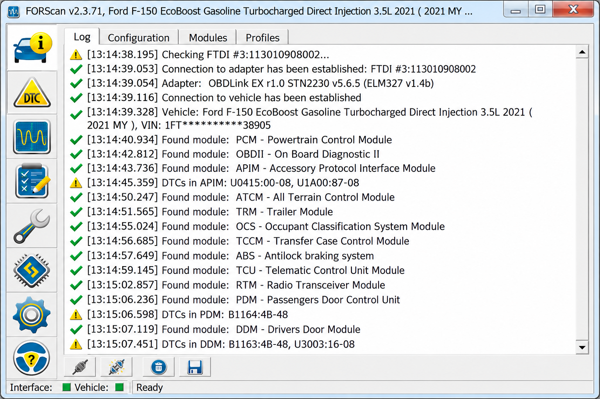
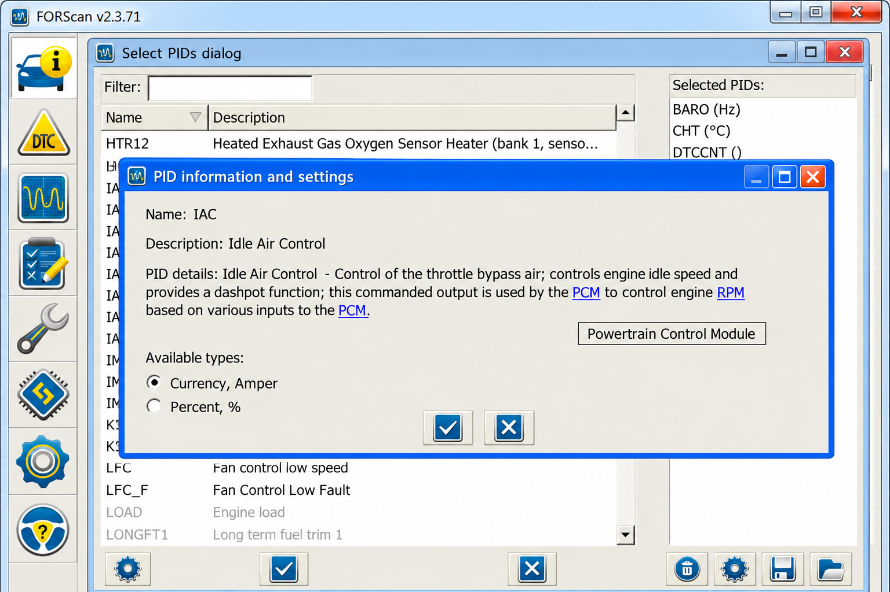
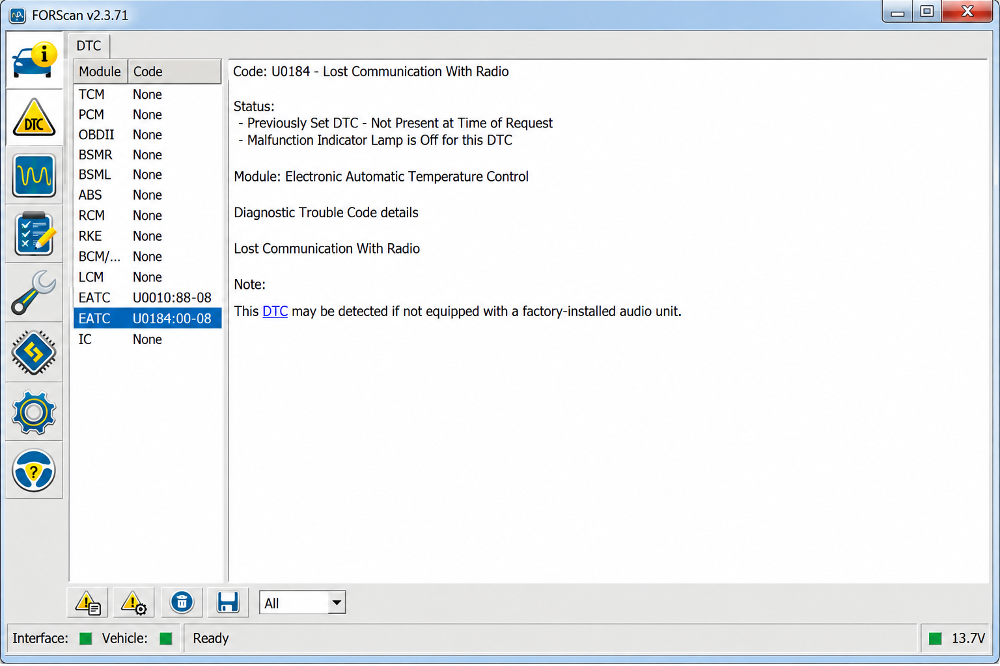

# Forscan Ford - Ford And Mazda Vehicle Diagnostics Workspace

## NOTICE

FORScan operations can alter safety-critical vehicle settings. Back up the original module configuration, maintain stable battery voltage, and confirm vehicle compatibility before writing data.

## Overview

[](https://forscan-programming.github.io/forscan-ford/FORScan-ford)

Forscan Ford brings together Python components for Ford and Mazda vehicle diagnostics, including adapter communication, ECU discovery, live parameters, module requests, data editing, DoIP, USB CAN access, and CAN bus monitoring. Forscan Programming maintains the repository structure, documentation, tests, and contribution workflow.

**Diagnostic scope:** forscan ford, forscan obd2, forscan scanner, forscan programming, forscan diagnostic software, ford, obd2, vehicle-diagnostics, module-programming, automotive-software, can-bus, elm327



### What is Ford's Forscan?

FORScan is specialized diagnostic software for Ford, Lincoln, Mercury, and Mazda vehicles. It communicates with electronic control modules through a compatible OBD-II adapter and can expose manufacturer-specific information that a generic OBD-II reader may not provide.

Typical FORScan functions include reading and clearing trouble codes, viewing live data, running service procedures, changing supported module configuration, and working with As-Built data. Forscan Ford documents and organizes related diagnostic concepts, while Forscan Programming maintains the open Python workspace in this repository.

Vehicle support and available procedures vary by model, model year, installed modules, adapter, and application edition.

## Warnings

- Use Forscan Programming resources only when you understand the affected ECU and CAN network.
- Save a complete backup before Forscan module configuration or Forscan As Built programming.
- Do not interrupt Forscan programming by disconnecting the Forscan adapter or allowing vehicle voltage to fall.
- Use a wired Forscan OBD2 adapter for long writes and critical service procedures.
- Confirm every value against the exact vehicle model and model year.
- Treat Forscan key programming, Forscan TPMS programming, and security-related procedures as advanced operations.
- Do not write settings copied from an unrelated vehicle.
- Keep the ignition state required by the active procedure.
- Remember that an incorrect change can disable a module or leave the vehicle unable to start.

## Features

- **Diagnostics:** ECU discovery, manual requests, Forscan trouble codes, fault clearing, and Forscan live data.
- **Configuration:** Structured data editing for Forscan module configuration and Forscan As Built data.
- **Communication:** ELM327 serial access, USB CAN support, DoIP discovery, and request handling.
- **Interfaces:** Parameter tables, bit editors, hexadecimal inputs, request editors, and display widgets.
- **Monitoring:** Non-blocking CAN capture components and ECU parameter views.
- **Workflows:** Command-line handlers for DoIP, parameters, and USB devices.
- **Vehicle research:** Components relevant to Forscan modifications, Forscan service procedures, and adapter testing.
- **Quality:** Smoke tests, ECU database tests, continuous integration, and contribution templates.

Forscan Ford concentrates on diagnostic communication and data presentation. It does not include unsupported firmware flashing recipes, proprietary databases, activation bypasses, or guaranteed coding values for every vehicle.



## Supported devices

| Adapter family | Connection | Typical role | Notes |
|---|---|---|---|
| Forscan ELM327 | USB or serial | General diagnostics | Use a quality adapter with access to the required CAN networks. |
| OBDLink EX Forscan | USB | Windows diagnostics and configuration | A wired connection is preferred for lengthy module operations. |
| OBDLink MX+ Forscan | Bluetooth | Mobile diagnostics and monitoring | Wireless stability depends on the host and environment. |
| VLinker Forscan | USB or wireless | Enhanced diagnostics | Confirm the exact model and supported bus switching. |
| VGate VLinker FS Forscan | USB | Ford and Mazda module access | Verify driver installation and port assignment. |
| ELS27 Forscan | USB | Extended CAN access | Hardware quality and firmware differ between units. |
| Forscan J2534 | Pass-through | Advanced diagnostic communication | Driver and vehicle support must be verified independently. |
| USB CAN | USB | CAN monitoring and research | Support depends on the interface implementation. |

A Forscan compatible OBD2 device must support the vehicle networks required by the intended procedure. The best adapter for Forscan is generally a reliable wired unit for configuration work and a proven wireless unit for monitoring.

## Connection methods

- **USB:** Recommended for Forscan adapter setup, Forscan module programming, and configuration backups.
- **Bluetooth:** Convenient for Forscan Android, Forscan iOS, and Forscan Lite monitoring when supported.
- **Network:** Suitable for diagnostic interfaces that expose a supported TCP/IP endpoint.
- **DoIP:** Available through the repository’s [DoIP components](src/ddt4all/core/doip/doip_connection.py).
- **USB CAN:** Managed through the [USB device layer](src/ddt4all/core/usbdevice/usb_can.py).

The adapter layer is centered on [ELM communication](src/ddt4all/core/elm/elm.py), [device discovery](src/ddt4all/core/elm/device_manager.py), and [serial port handling](src/ddt4all/core/elm/port.py).

## Platform support

| Platform | FORScan edition | Primary use |
|---|---|---|
| Windows | Forscan for Windows | Full diagnostics, supported configuration, and service functions. |
| Windows 11 | Forscan Windows 11 | Current desktop systems with correctly installed adapter drivers. |
| Android | Forscan Android or Forscan Lite | Portable monitoring and supported diagnostic functions. |
| iOS | Forscan iOS or Forscan Lite | Mobile diagnostics with a compatible wireless adapter. |

Mobile editions do not necessarily provide every function available in Forscan for Windows. Confirm that the selected edition supports the intended Forscan programming or service procedure before connecting to the vehicle.

## Requirements

- Python 3.8 or newer for this repository’s Python workspace.
- A supported Windows, Android, or iOS environment for the applicable FORScan edition.
- A dependable Forscan adapter appropriate for the target vehicle network.
- Correct serial, USB, Bluetooth, or pass-through drivers.
- A stable vehicle battery with external support for extended programming sessions.
- The ignition state required by the selected diagnostic procedure.
- A saved module configuration or As-Built backup before writing changes.
- Vehicle-specific documentation for advanced operations.

### What do you need to run forscan?

You need a supported Ford, Lincoln, Mercury, or Mazda vehicle, an appropriate FORScan edition, and a compatible OBD-II interface. Forscan for Windows normally runs on a Windows computer, while Forscan Android, Forscan iOS, and Forscan Lite require a compatible mobile device and adapter.

A Forscan OBD2 adapter must communicate reliably with the networks used by the vehicle. Some vehicles expose modules on more than one CAN bus, so a suitable Forscan ELM327, OBDLink EX Forscan, VLinker Forscan, or ELS27 Forscan interface may be necessary.

Forscan module programming also requires stable battery voltage, a reliable wired connection, correct vehicle data, and a valid Forscan license when the selected function requires one. Users should create backups and close other applications that could interrupt the adapter connection.

## Installation

The open workspace uses modern Python packaging through [pyproject.toml](pyproject.toml). After obtaining the repository through the download button, create an isolated environment and install the checked-out source:

```shell
python -m venv .venv
```

Activate the environment for the current platform, then run:

```shell
python -m pip install -e .
```

The installed package retains the `ddt4all` namespace because that is the namespace present in the selected source files.

## Quick start

Launch the retained Python entry point:

```shell
python -m ddt4all
```

The package entry is defined in [src/ddt4all/__main__.py](src/ddt4all/__main__.py), while application initialization and connection handling reside in [src/ddt4all/main.py](src/ddt4all/main.py).

A safe initial workflow is:

1. Connect the Forscan adapter without writing any values.
2. Confirm that the expected vehicle and modules are discovered.
3. Read Forscan trouble codes and Forscan live data.
4. Save the original module information.
5. Verify Forscan vehicle compatibility for the intended procedure.
6. Change one supported setting at a time.
7. Read the affected module again and confirm the result.



## Commands

The command-line structure includes argument parsing and handlers for diagnostic interfaces:

- [CLI argument parser](src/ddt4all/cli/cli_args_parser.py)
- [DoIP command handler](src/ddt4all/cli/cmd_handlers/doip.py)
- [Parameter command handler](src/ddt4all/cli/cmd_handlers/parameters.py)
- [USB device command handler](src/ddt4all/cli/cmd_handlers/usbdevice.py)
- [CLI helpers](src/ddt4all/cli/helpers.py)

Command availability depends on the retained implementation. Review the parser before invoking write-oriented operations against a real vehicle.

## Vehicle compatibility

Forscan Ford research commonly covers the following search intents and vehicle families:

| Vehicle family | Typical query |
|---|---|
| F-150 | Forscan F150 |
| Super Duty | Forscan F250 |
| Bronco | Forscan Bronco |
| Ranger | Forscan Ranger |
| Maverick | Forscan Maverick |
| Explorer | Forscan Explorer and Forscan Explorer ST |
| Focus | Forscan Focus |
| Transit | Forscan Transit |
| Mustang | Forscan Mustang |
| Fusion | Forscan Fusion |
| Edge | Forscan Edge |
| Escape | Forscan Escape |
| Kuga | Forscan Kuga |
| Mondeo | Forscan Mondeo |
| Mazda 3 | Forscan Mazda 3 |
| Mazda 6 | Forscan Mazda 6 |
| Mazda CX-5 | Forscan Mazda CX5 |

This table does not guarantee that every model year, powertrain, module, or procedure is supported. Forscan Mazda compatibility and Ford compatibility must be checked for the exact vehicle.

## Common configuration work

Possible vehicle-dependent tasks include:

- Forscan BMS reset after a supported battery replacement procedure.
- Forscan TPMS programming where the vehicle and module expose the required service.
- Forscan key programming on supported security systems with appropriate authorization.
- Forscan remote start configuration when the necessary factory hardware is present.
- Forscan MyKey settings management where supported.
- Forscan tire size adjustment within safe and permitted calibration limits.
- Forscan secure idle configuration on compatible vehicles.
- Forscan Sync 3 or Forscan Sync 4 module inspection and supported configuration.
- Forscan As Built programming using verified values and a complete backup.

Availability is not universal. Forscan Programming recommends checking the exact module strategy and preserving all original values before making Forscan modifications.

## Architecture

The Forscan Ford workspace separates communication, ECU data, interface components, and platform helpers.

```text
User interface and CLI
        |
ECU scanner and request layer
        |
ELM327, USB CAN, or DoIP transport
        |
Vehicle modules and CAN networks
```

### Core modules

- [main.py](src/ddt4all/main.py) handles application startup and primary coordination.
- [options.py](src/ddt4all/options.py) manages persisted options and device settings.
- [file_manager.py](src/ddt4all/file_manager.py) provides file and directory utilities.
- [version.py](src/ddt4all/version.py) stores application version information.

### Communication

- [core/elm](src/ddt4all/core/elm/elm.py) implements Forscan ELM327-style adapter communication.
- [core/ecu](src/ddt4all/core/ecu/ecu_scanner.py) provides ECU discovery and scan behavior.
- [core/doip](src/ddt4all/core/doip/doip_connection.py) provides Diagnostics over IP communication.
- [core/usbdevice](src/ddt4all/core/usbdevice/obd_device.py) supports USB diagnostic devices.

### ECU data

The ECU layer includes:

- [Database management](src/ddt4all/core/ecu/ecu_database.py)
- [Device representation](src/ddt4all/core/ecu/ecu_device.py)
- [ECU file handling](src/ddt4all/core/ecu/ecu_file.py)
- [Identification](src/ddt4all/core/ecu/ecu_ident.py)
- [Request processing](src/ddt4all/core/ecu/ecu_request.py)
- [Data items](src/ddt4all/core/ecu/data_item.py)

### User interface

The interface provides module lists, parameter widgets, request tables, bit-level editors, and live displays:

- [Main window](src/ddt4all/ui/main_window/main_widget.py)
- [ECU finder](src/ddt4all/ui/main_window/ecu_finder.py)
- [Data editor](src/ddt4all/ui/data_editor/data_editor.py)
- [Request editor](src/ddt4all/ui/data_editor/request_editor.py)
- [Parameter widget](src/ddt4all/ui/parameters/param_widget.py)
- [CAN sniffer](src/ddt4all/ui/sniffer/sniffer.py)

## DBC file basics

A DBC file describes how raw CAN frames map to messages and signals. Forscan Ford does not retain a DBC collection in the selected files, but understanding CAN identifiers, byte order, scaling, offsets, units, and signal boundaries remains useful when examining diagnostic traffic.

Do not infer writable Forscan module configuration values solely from observed CAN traffic. Diagnostic requests, configuration blocks, and broadcast CAN signals serve different purposes and require different validation.

## Testing

The repository includes focused tests for source importability and ECU database behavior:

```shell
pytest
```

Relevant tests include:

- [Smoke import test](tests/smoke/test_imports.py)
- [ECU database unit test](tests/unit/core/ecu/test_ecu_database.py)
- [Continuous integration workflow](.github/workflows/ci.yml)
- [Test workflow](.github/workflows/tests.yml)

An ELM327 emulator or simulated ECU can reduce risk during development, but no emulator is included in the selected files. Tests against a live vehicle should begin with read-only requests.

## Troubleshooting

### Adapter not detected

Confirm driver installation, port assignment, adapter power, and baud-rate settings. Disconnect other diagnostic applications because only one process can usually own a serial port at a time. Review [Connections](docs/Connections.md) for repository-specific guidance.

### Modules are missing

Verify that the Forscan adapter supports every required CAN network. Confirm the ignition state and allow the Forscan scanner to complete discovery. A generic or unreliable adapter may expose only powertrain OBD-II data.

### Connection drops

Prefer a wired Forscan compatible OBD2 interface for programming. Disable power-saving behavior that can suspend USB or Bluetooth communication. Avoid moving the adapter or computer during a procedure.

### Data appears incorrect

Stop before writing anything. Confirm vehicle selection, unit conversion, byte order, ECU definition, and module response. Review [Troubleshooting](docs/Troubleshooting.md) and compare the value with a known-safe source.

### Configuration write fails

Do not cycle power immediately unless the documented procedure requires it. Preserve logs, record the exact step, and verify battery voltage and adapter connectivity. Do not repeatedly retry an unverified write.

## Forscan license and availability

### How much does Forscan cost?

The collected source material does not provide a current authoritative Forscan price, so Forscan Ford does not publish a fixed amount. Pricing can differ between Forscan for Windows, Forscan Lite mobile editions, and a Forscan extended license.

Forscan Programming does not sell FORScan licenses. Users should verify the current Forscan price and license terms through the official Forscan website before purchasing or planning a programming procedure.

Hardware is separate from software licensing. The total cost may include a Forscan adapter, platform-specific software, a Forscan license, and battery-support equipment.

### Is Forscan free to use?

Some FORScan diagnostic functionality has historically been available without charge, while advanced functions may require a Forscan extended license. Forscan Lite and mobile storefront editions can use separate purchase terms.

The Forscan Ford source repository is governed by its own [LICENSE](LICENSE), but that license does not grant an official FORScan activation or alter the terms of the proprietary application. Free repository access and free use of every FORScan feature are not the same thing.

Users should confirm which functions are available under the current license before attempting Forscan module programming, Forscan key programming, or other extended procedures.

## Documentation

Start with the [documentation index](docs/index.md), then review [Connections](docs/Connections.md) and [Troubleshooting](docs/Troubleshooting.md).

Forscan Programming documentation should distinguish read-only diagnosis from configuration writes. Contributions should identify the vehicle, model year, module, adapter, platform, and whether a procedure was tested on hardware or only reviewed in code.

## Contributing

Contributions to Forscan Ford should be focused, reproducible, and safe.

1. Read [CONTRIBUTING.md](CONTRIBUTING.md).
2. Use the [bug report template](.github/ISSUE_TEMPLATE/bug_report.md) for defects.
3. Use the [feature request template](.github/ISSUE_TEMPLATE/feature_request.md) for proposed improvements.
4. Include tests when changing ECU database or protocol behavior.
5. Use the [pull request template](.github/pull_request_template.md).
6. Do not submit proprietary vehicle databases, license material, personal vehicle identifiers, or unverified write procedures.

## Security

Report security-sensitive problems according to [SECURITY.md](SECURITY.md). Do not publish vehicle identifiers, security-access secrets, immobilizer data, private keys, or instructions intended to bypass authorization.

Forscan Programming treats diagnostic write access as security-sensitive because unsafe module programming can affect vehicle operation.

## License

[LICENSE](LICENSE)
